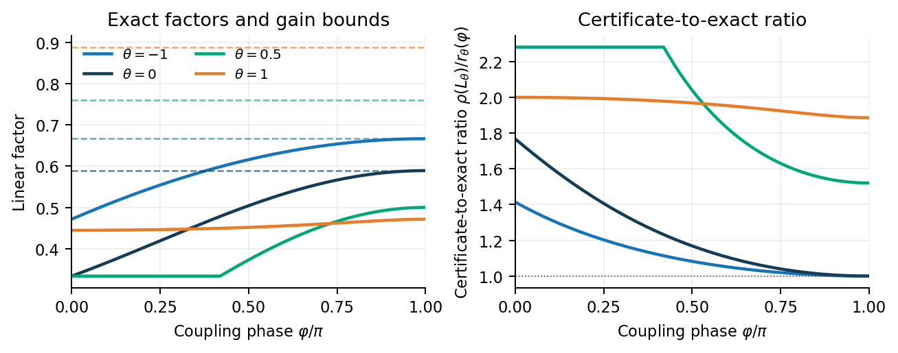
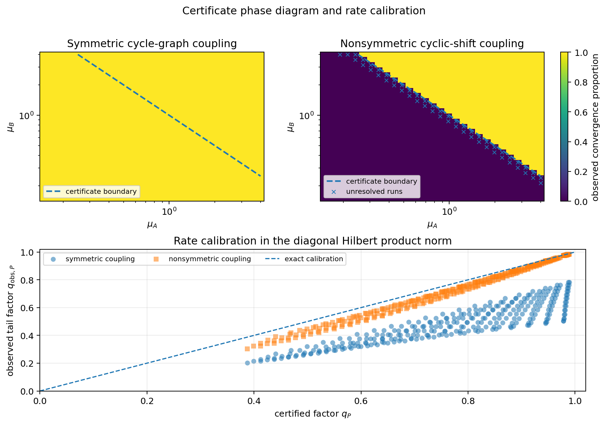
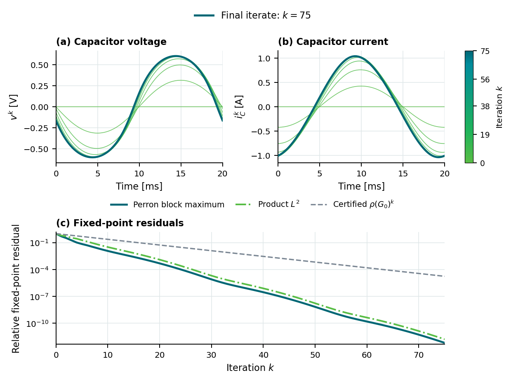

# Splitting Compositions of Monotone Operators

This repository contains Python scripts for the numerical experiments accompanying *Splitting Compositions of Monotone Operators* by Haoming Qu, Yefan Wu, and Thomas Chaffey.

## Reproduce the experiments

From the repository root, install the tested dependencies and run the scripts.

```bash
python -m pip install numpy==2.3.5 matplotlib==3.10.8
python phase_analysis.py
python rlc_experiment.py
```

The reference runs used Python 3.12.14. Both scripts write figures to
`figures/` and numerical results to `data/` in the repository root.

### Coupling-phase scan

[`phase_analysis.py`](phase_analysis.py) evaluates the exact modal factor at
361 equally spaced coupling phases $\varphi\in[0,\pi]$ and compares it with the
gain certificate. The scan uses $\theta\in\{-1,0,1/2,1\}$,
$\alpha=\beta=L_H=1$, and $\ell_A=\ell_B=1/3$. The exact factor attains the
certificate at $\varphi=\pi$ for $\theta=-1$ and $\theta=0$. The certificate
is strictly above the exact factor across the scan for the two positive values
of $\theta$.



[Vector PDF](figures/phase_resolved_gain_sharpness.pdf) ·
[Numerical summary](data/phase_calibration_summary.json)

### Convergence-rate calibration

The same script compares symmetric cycle and nonsymmetric cyclic-shift couplings
in dimension 40. Each modulus uses 29 logarithmically spaced values in
$[0.15,4]$, with eight starts per parameter pair and coupling, random seed
`20261112`, $\alpha=\beta=1$, and $\theta=0$. Each coordinate of the reference
state has a random sign and a magnitude uniform on $[0.5,1]$. The initial
state is the reference state plus twice a standard Gaussian perturbation.

A run reaches its target when $E_k\leq10^{-8}$, where $E_k$ is the Euclidean
pair error divided by the greater of 1 and the reference pair norm. A nonfinite
error or $E_k>10^6\max(1,E_0)$ is classified as numerical divergence. The
remaining runs are unresolved after 5,000 iterations. For target-reaching
runs at certified points ($\mu_A\mu_B>1$), the script fits the log error in
the certificate's diagonal Hilbert norm from
$\max(1,\lfloor 0.3k\rfloor,k-60)$ through the stopping iteration $k$, using
at least nine finite samples. It takes the median fitted factor across
qualifying starts for each parameter pair.

All 2,400 certified starts reached the target for each coupling. The median
observed-to-certified factor across parameter pairs was 0.6177 for the
symmetric cycle and 0.9429 for the nonsymmetric shift.



[Vector PDF](figures/certificate_phase_rate_calibration.pdf) ·
[Numerical summary](data/phase_calibration_summary.json) ·
[Calibration arrays](data/phase_calibration_data.npz)

### Nonlinear RLC circuit

[`rlc_experiment.py`](rlc_experiment.py) computes the periodic response of the
nonlinear circuit. The source is a 50 Hz sinusoid with a 1 V peak and period
$T=0.02\,\mathrm{s}$. The centered periodic derivative uses $N=100$ samples,
with spacing $h=0.0002\,\mathrm{s}$ and half-wave antisymmetry. The circuit
parameters are $L=0.005\,\mathrm{H}$, $R=5\,\Omega$,
$C_0=0.004\,\mathrm{F}$, and $C_3=0.004\,\mathrm{F/V^2}$ for the capacitor law
$Q(v)=C_0v+C_3v^3$. The six state variables start at zero, with
$\alpha=1$, $\beta=1000$, and $\theta=0$.

The fixed-point residual is the norm of $\mathcal{T}z^k-z^k$, divided by
the norm of $\mathcal{T}z^0-z^0$. The plot shows both the product norm and the
Perron-weighted block maximum norm. The latter takes the maximum of the
discrete $L^2$ block norms divided by the corresponding positive Perron
weights. The script stops when that relative residual $r_{w,k}$ is at most
$10^{-12}$, with a limit of 2,000 iterations. The observed factor comes from
a log-linear fit over $10^{-9}<r_{w,k}<10^{-4}$. The capacitor current in the
plot is $i_C^k=D_N Q(v^k)$.

The reference run stopped at iteration 75 with $r_{w,75}\approx6.61\times10^{-13}$.
The observed tail factor was 0.6976, compared with a certified
factor of 0.8641. The peak capacitor voltage and current magnitudes were
0.6010 V and 1.0407 A, respectively.



[Vector PDF](figures/rlc_convergence.pdf) ·
[Numerical summary](data/rlc_summary.json) ·
[Residual history](data/rlc_residuals.csv) ·
[Terminal waveforms](data/rlc_waveforms.csv)

## Citation

If you use this code in your research, please cite our paper:

Haoming Qu, Yefan Wu, and Thomas Chaffey. “Splitting Compositions of Monotone Operators.” [arXiv:2610.39480](https://arxiv.org/abs/2610.39480), 2026.
